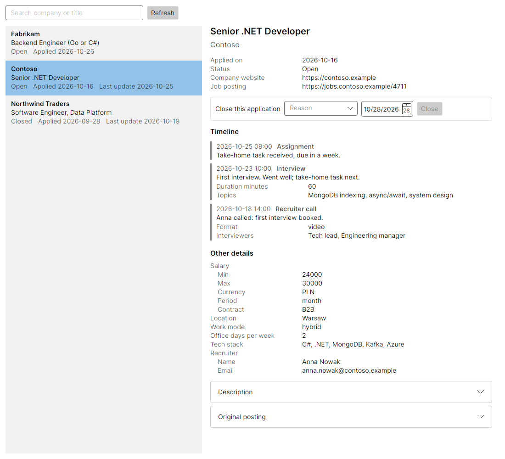

# JobTracker

A tracker for the jobs I apply for. I paste a job offer into Claude Code; a skill turns it into JSON and posts it to
a small local service, which stores it in MongoDB. A read-only desktop app shows what is stored: the standard
properties, the timeline of everything that happened, and whatever else the posting said, whatever its shape.

Its real purpose is learning a document database (MongoDB) and doing the data layer properly, test first.



## How the parts fit

```
 pasted job offer ──► Claude Code + job-applications skill ──POST──►  JobTracker.Api  ──►  MongoDB
                                                                          ▲
                                         JobTracker.UI (read-only) ──GET──┘
```

The HTTP contract between them is [docs/api.md](docs/api.md).

## Prerequisites

- .NET 10 SDK (`dotnet --version` should print `10.0.100` or a later 10.0 feature band; see `global.json`)
- Docker Desktop, running. The MongoDB integration tests start their own MongoDB container, and
  `docker compose up -d` runs one for the service.
- Claude Code, for the skill. No API key: it runs on a normal Claude subscription.

## Commands

```powershell
dotnet build JobTracker.slnx                      # fast, no analyzers
dotnet build JobTracker.slnx -c Debug_Analyzers   # the gate: full analyzer set, warnings as errors
dotnet test --solution JobTracker.slnx            # all tests, including MongoDB integration tests

docker compose up -d                              # MongoDB for the service
dotnet run --project src/JobTracker.Api           # the service, http://localhost:5080
dotnet run --project src/JobTracker.UI            # the app
dotnet run --project src/JobTracker.UI -- --sample   # the app on built-in sample data, no service needed
```

In Claude Code, in this folder, paste a job offer and say you applied. Until the service has its endpoints,
the skill keeps new applications in `inbox/` and sends them when asked.

## Solution layout

| Project | What goes there | May reference |
|---|---|---|
| `src/JobTracker.Contracts` | The wire format: request and response records, JSON options, routes. | nothing |
| `src/JobTracker.Domain` | Entities, value objects, business rules. Plain C#. | nothing |
| `src/JobTracker.Application` | Use cases and ports (interfaces such as repositories). | Domain |
| `src/JobTracker.Infrastructure.MongoDb` | The data layer: implements the ports with the MongoDB driver. | Application, MongoDB.Driver |
| `src/JobTracker.Api` | The local service: minimal API endpoints, and the composition root. | Contracts, Application, Infrastructure |
| `src/JobTracker.UI` | Avalonia desktop app (MVVM, CommunityToolkit.Mvvm). Read-only plus Close. | Contracts |
| `tests/JobTracker.TestSupport` | Shared test helpers. A library, not a test project. | - |
| `tests/*.Tests` | One test project per project above. xUnit v3, Shouldly, Moq. | the project under test, TestSupport |

Domain, Application, Infrastructure and the API endpoints are intentionally empty: I'm writing them myself, test
first.

## Testing conventions

Tests are written test first, to the rules in [docs/conventions/test-antipatterns.md](docs/conventions/test-antipatterns.md):
a three-line Trigger / Behavior / Assertion header on every test, `Subject_WhenCondition_ExpectedOutcome` names,
Shouldly assertions on literal values, Moq for mocks, timeouts from `TestTimeouts`, and no wall clock.
`AGENTS.md` has the definition of done.
